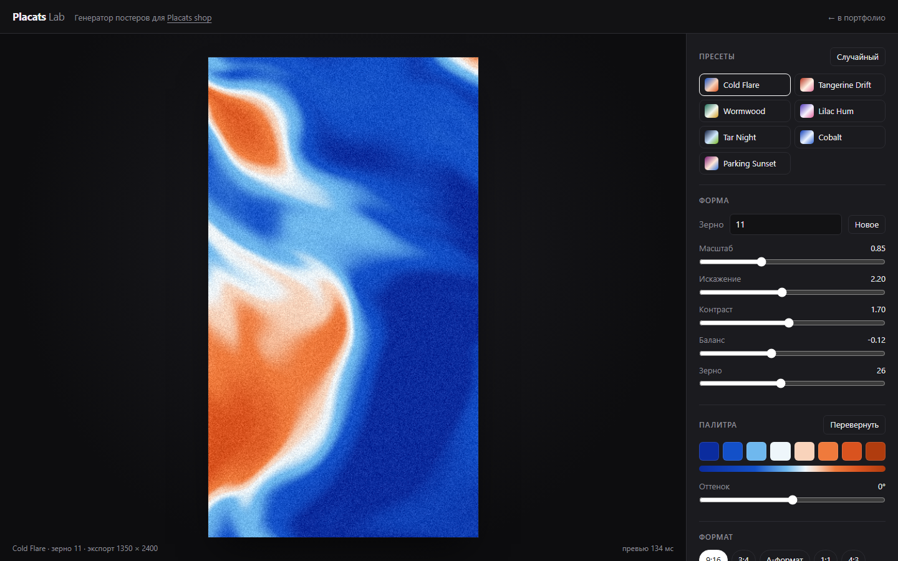

# Placats Lab — генератор градиентных постеров

Браузерный инструмент, которым сделаны постеры [Placats shop](../dysph-poster-shop/README.md): «жидкие» градиенты с плёночным зерном. Двигаешь ползунки — превью перерисовывается сразу, готовый постер скачивается в PNG до 4800 px по длинной стороне.



Открыть: `index.html` через любой локальный сервер (модули и воркеры не работают с `file://`).

## Что можно делать

- **Пресеты** — семь постеров магазина. Можно взять любой за основу.
- **Форма:** зерно генератора (одно число — одна композиция), масштаб, искажение, контраст, баланс светлого и тёмного, сила зерна.
- **Палитра:** клик по цвету — свой цвет, «Перевернуть» — палитра наоборот, «Оттенок» — сдвиг всех цветов по кругу.
- **Формат:** 9:16, 3:4, A-формат, 1:1, 4:3.
- **Случайный** (или клавиша R) — новое зерно, параметры в пределах, где картинки выходят удачными, палитра одного из пресетов, иногда со сдвигом оттенка.
- **Экспорт PNG** 1200 / 2400 / 4800 px с полосой прогресса.
- **Ссылка** — все параметры хранятся в адресе страницы, по ссылке открывается тот же постер.

## Как устроено

```
core.js      алгоритм — чистый модуль без DOM и Node
presets.js   семь постеров магазина
worker.js    считает картинку в фоне
app.js       интерфейс
```

Алгоритм: шум Перлина в три октавы → двойное искажение координат (domain warping: поле «затекает» само в себя, отсюда языки и острые изгибы) → цветовая шкала с плавными переходами между точками → зерно. Формы зависят только от параметров, а не от разрешения, поэтому превью 800 px и экспорт 4800 px — одна и та же композиция.

Расчёт идёт в двух воркерах: один для превью, второй для экспорта. Пока превью считается, новые изменения ползунков не копятся в очередь — после текущего кадра считается только последнее состояние. Превью 800 px считается примерно за 100–300 мс.

**Одно ядро на два проекта.** `core.js` и `presets.js` использует и этот интерфейс, и скрипт магазина `dysph-poster-shop/scripts/generate-art.js`, который готовит картинки для каталога. После переноса генератора сюда все семь постеров магазина совпали с прежними байт в байт.

---

Проект из портфолио dysphoblond.
